  

<table align="center" width="80%" border="0">
  <tr>
    <td valign="top" align="left">

### currently
Building **Adversyn**, an open-source AI security and red-teaming venture, and learning how to make LLM systems fail safely. I work on Linux every day.

### interests
- **AI / ML engineering** — inference serving, classical and quantum ML, agents
- **Adversarial AI** — prompt injection, red-teaming, LLM/RAG security testing
- **Systems engineering** — queues, gateways, self-hosted infrastructure

    </td>
    <td valign="top" align="right" width="36%">
      <a href="mailto:tejsagar111@gmail.com">tejsagar111@gmail.com</a> 
      <a href="https://github.com/tej-1916">github.com/tej-1916</a>
    </td>
  </tr>
</table>

 

## selected work

Public repositories only. Status is quoted from each repo's own README.

| Project | What it is | Status |
|---|---|---|
| [**AegisLM**](https://github.com/tej-1916/aegislm) | Security testing toolkit for LLM and RAG applications (Python) | Early scaffolding — not ready for real assessments |
| [**ORBI**](https://github.com/tej-1916/orbi-inference) | Distributed LLM inference control plane: API gateway, worker registry, durable PostgreSQL queue, idempotency, scoped worker JWTs | v0.1, Phase 1 foundation |
| [**PACTRA**](https://github.com/tej-1916/pactra) | Deterministic transaction verification for agentic commerce, built for the Razorpay Buildathon | See repo |
| [**Quantum Earth**](https://github.com/tej-1916/quantum-earth) | Classical and quantum ML for Earth-observation image classification | Prototype |
| [**Ostra**](https://github.com/tej-1916/ostra) | Turns an old Ubuntu laptop into a home-cloud server and AI-agent platform (FastAPI, Supabase, TypeScript) | Phases 0–2 complete per README; more planned |
| [**Agent UI Reference System**](https://github.com/tej-1916/agent-ui-reference-system) | Context repo that gives coding agents a design process instead of one more template | See repo |
| [**Tern Agent**](https://github.com/tej-1916/tern-agent) | Terminal AI automation agent | Planned features |

Other work (ASTA traffic analyzer, ZeroFree, ARGUS) is private or not yet public.

## stack

`Python` · `Java` · `Bash` · `FastAPI` · `PostgreSQL` · `Docker` · `OpenCV` · `Supabase` · `n8n` · `LangGraph` · `Ollama` · `pytest` · `GitHub Actions` · `Linux`

 

Open to AI engineering internships · <a href="mailto:tejsagar111@gmail.com">get in touch</a>

